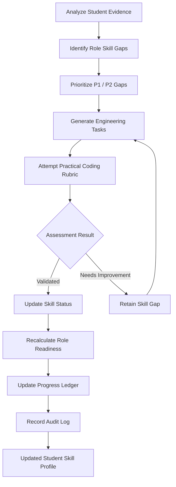
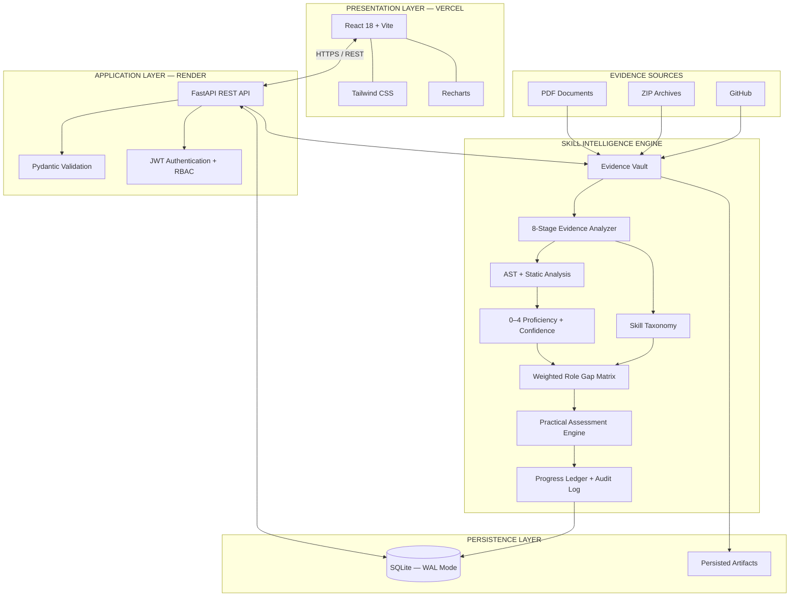

# 🧠 SkillGraph
### Students list skills. We check the evidence.

**An AI-powered, evidence-based skill intelligence platform that transforms student projects into explainable, verifiable competency profiles.**

<p align="center">
  <strong>Built by Team Kaizen — Sharon & Santhosh</strong><br/>
  Prasunex Innovathon 2026
</p>

<p align="center">
  <a href="https://skillgraph-mvp-henna.vercel.app/"><strong>🚀 LAUNCH LIVE MVP</strong></a>
  &nbsp;·&nbsp;
  <a href="https://skillgraph-api-n7i9.onrender.com/docs">API Documentation</a>
  &nbsp;·&nbsp;
  <a href="https://github.com/Sharonmedithi0304/skillgraph-mvp">Source Code</a>
</p>

<p align="center">
  
  
  
  
  
  
</p>

---

## 01. The Problem We're Solving

**Everyone lists skills on a resume. Almost nobody checks the proof.**

A student can list Python, Docker, SQL, REST APIs, and Machine Learning on a resume. But how do recruiters know whether these skills are actually demonstrated through engineering work?

The problem extends beyond resume screening.

| The Challenge | Why Existing Approaches Fall Short |
|---|---|
| Skill credibility | Certificates and self-declared skills do not necessarily demonstrate practical competence. |
| Scattered evidence | Projects, repositories, reports, and assessments exist independently. |
| Unclear role readiness | Students struggle to understand how their current skills map to industry expectations. |
| Generic assessments | Traditional quizzes test theoretical knowledge rather than actual engineering ability. |
| No improvement loop | Students rarely receive a structured roadmap derived from their demonstrated skill gaps. |

### The fundamental gap

Students need to understand three things:

- **A — Claimed Skills:** What I say I know.
- **B — Demonstrated Competence:** What my actual work and assessments support.
- **C — Target Role Requirements:** What my intended engineering role expects.

SkillGraph connects all three.

We transform repositories, project archives, technical documentation, and practical coding assessments into an explainable, audit-logged role-readiness system.

**Our principle: Repository ownership is not proficiency. Evidence must support the claim.**

---

## 02. Introducing SkillGraph

SkillGraph is a full-stack skill intelligence platform designed to evaluate technical competencies through actual project evidence rather than relying exclusively on self-reported proficiency.

It creates a structured relationship between:

**Student → Skills → Evidence → Analysis → Verification → Role Readiness → Improvement**

Unlike conventional skill assessment platforms, SkillGraph combines multi-source evidence analysis, explainable scoring, role-specific competency benchmarks, practical assessments, and continuous progress tracking.

### What makes it different?

| Conventional Platforms | SkillGraph |
|---|---|
| Self-declared skill lists | Evidence-linked competencies |
| Certificate-oriented evaluation | Project-oriented evaluation |
| Generic quiz assessments | Practical coding rubrics |
| Black-box skill scores | Explainable three-axis evaluation |
| Generic course recommendations | Role-specific gap prioritization |
| Static profiles | Continuously updated skill intelligence |
| Unverified proficiency claims | Evidence status and confidence signals |

---

## 03. Live Production MVP — Judge Walkthrough

<blockquote>
  <strong>Experience the working product, not just the presentation.</strong>
  <br/>
  Both student and faculty experiences are accessible through the deployed application.
</blockquote>

<details>
<summary><strong>🎓 Student Portal — Judge Demo</strong></summary>

**Access:** One-Click Judge Student Demo

Email: `alex.rivera@kaizen.edu`

Explore:

- Existing technical skill profiles.
- Explainable proficiency scores from 0–4.
- GitHub repository submission and analysis.
- ZIP project archive uploads.
- Practical coding rubric assessments.
- Role-specific readiness calculations.
- Progress tracking and reassessment.

</details>

<details>
<summary><strong>🧑‍🏫 Faculty & Placement Mentor Portal</strong></summary>

**Access:** Standard Login

Email: `dr.mehta@kaizen.edu`

Password: `Mentor2026!`

Explore:

- Submitted student artifacts.
- Supporting code evidence.
- Skill verification and mentor endorsement.
- Student competency information.
- Cohort-level skill gap trends.
- Mentor-facing evaluation workflows.

</details>

**Live endpoints**

- Frontend: https://skillgraph-mvp-henna.vercel.app/
- Backend: https://skillgraph-api-n7i9.onrender.com
- Interactive API documentation: https://skillgraph-api-n7i9.onrender.com/docs

**Judge tip:** The backend uses Render's free tier. After approximately 15+ minutes of inactivity, its first request may require 30–45 seconds to wake up.

---

## 04. Core Innovations & Technical Capabilities

### 4.1 Multi-Source Evidence Ingestion

SkillGraph does not restrict students to a single evidence format.

It accepts three major sources of technical evidence.

**A. Live GitHub Repository Inspection**

- Read-only repository inspection.
- Repository file-tree analysis.
- Commit history and development activity signals.
- Dependency and configuration inspection.
- Source-code structure analysis.

**B. ZIP Project Archive Analysis**

- Project archive extraction and inspection.
- Source-code and directory analysis.
- Abstract Syntax Tree (AST) and static analysis signals.
- Dependency and configuration identification.
- Secure archive extraction with Zip-Slip path-traversal protection using canonical path boundary enforcement.

**C. PDF Documentation Analysis**

- Technical project reports.
- Architecture descriptions.
- Lab write-ups.
- Supporting engineering documentation.
- Extracted technical signals for evidence evaluation.

The platform brings different evidence formats into a unified skill evaluation workflow.

### 4.2 Security-First Evidence Processing

Evidence analysis must not introduce new security vulnerabilities.

SkillGraph incorporates security controls into its processing pipeline:

| Security Control | Purpose |
|---|---|
| Read-only GitHub inspection | Avoid modifying submitted repositories. |
| Zip-Slip protection | Prevent archive path traversal outside the intended extraction directory. |
| Canonical path validation | Enforce safe extraction boundaries. |
| Prompt-injection isolation | Treat repository files and README contents as untrusted data, never as model instructions. |
| Password hashing | PBKDF2-SHA256-based password protection. |
| JWT authentication | Secure authenticated API access. |
| Role-based access control | Separate student and mentor permissions. |
| Pydantic validation | Validate incoming API data. |

**Security principle:** User-submitted project content is evidence to inspect, not instructions to execute or follow.

### 4.3 Three-Axis Explainable Evaluation Engine

This is one of SkillGraph's most important innovations.

Most platforms collapse skill evaluation into a single number.

SkillGraph separates three independent evaluation dimensions.

**Axis 1 — Proficiency Level**

A structured 0–4 competency scale:

| Score | Level | Interpretation |
|---:|---|---|
| 0 | Not Demonstrated | No supporting evidence currently available. |
| 1 | Beginner | Claimed only; proficiency is capped without supporting evidence. |
| 2 | Developing | Supported by project evidence. |
| 3 | Proficient | Supported by multiple corroborating signals. |
| 4 | Advanced | Validated through practical assessment. |

**Axis 2 — Evidence Status**

- Claimed
- Project-Supported
- Assessment-Validated

**Axis 3 — Confidence Score**

A 10%–98% confidence indicator reflecting evidence reliability and corroboration across available artifacts.

These dimensions answer three different questions:

1. What is the estimated proficiency level?
2. What kind of evidence supports it?
3. How reliable is the available evidence?

The separation makes skill evaluation more transparent and interpretable.

### 4.4 Six-Pathway Role Readiness Engine

Students do not simply need to know which skills they possess.

They need to know whether those skills align with their target engineering roles.

SkillGraph benchmarks demonstrated competencies against six career pathways:

1. Backend Developer
2. Frontend Developer
3. Full Stack Developer
4. Data Analyst
5. AI/ML Engineer
6. Python Developer

Each pathway uses a weighted competency profile.

**Weighted Role Readiness Formula**

\[
\text{Role Match} =
\frac{\sum_i w_i\min(s_i,r_i)}
{\sum_i w_i r_i}
\times 100
\]

Where:

- \(w_i\) = importance weight of competency \(i\)
- \(s_i\) = student's assessed proficiency
- \(r_i\) = required proficiency for the target role

**Innovation 1 — Non-Offsetting Gap Rule**

A surplus in Git proficiency cannot hide a critical deficiency in SQL, Docker, or Testing.

Role readiness must expose important missing competencies instead of allowing unrelated strengths to conceal them.

**Innovation 2 — Fairness: Unassessed ≠ Unable**

Missing evidence is not automatically interpreted as zero ability.

SkillGraph distinguishes between demonstrated weakness and insufficient evidence, while explicitly representing evidence coverage.

This prevents an incomplete student profile from being misrepresented as a definitive measure of capability.

### 4.5 Closed-Loop Practical Assessment & Improvement

SkillGraph does not stop after identifying skill gaps.

It connects evaluation to improvement.



The improvement workflow includes:

- Ranked P1 and P2 engineering tasks.
- Role-specific gap prioritization.
- Interactive practical coding rubrics instead of trivial multiple-choice quizzes.
- Assessment-based skill validation.
- Updated proficiency and evidence status.
- Immediate role-readiness recalculation.
- Progress ledger updates.
- Audit-logged reassessment history.

**The result:** Students can see not only where they stand, but also what they need to improve next.

---

## 05. System Architecture

SkillGraph uses a layered full-stack architecture deployed across Vercel and Render.



### Architecture Breakdown

| Layer | Components | Responsibility |
|---|---|---|
| Presentation | React, Vite, Tailwind, Recharts | Student and mentor experiences |
| API | FastAPI, Pydantic | Request handling and validation |
| Security | JWT, PBKDF2-SHA256, RBAC | Authentication and access control |
| Evidence | GitHub, ZIP, PDF | Multi-source artifact ingestion |
| Intelligence | AST, taxonomy, scoring | Evidence analysis and competency evaluation |
| Assessment | Practical rubrics, role matrix | Gap prioritization and reassessment |
| Persistence | SQLAlchemy, SQLite WAL | Structured data and audit history |

### Deployment Architecture

| Component | Platform |
|---|---|
| Frontend | Vercel |
| Backend | Render |
| Database | SQLite with WAL mode |
| ORM | SQLAlchemy |
| API Protocol | HTTPS / REST |

**Future scale-out direction:** PostgreSQL for relational persistence, S3-compatible storage for artifacts, and asynchronous processing through Celery and Redis.

---

## 06. Technology Stack

| Technology | Application |
|---|---|
| Python 3.11+ | Backend development |
| FastAPI | REST API framework |
| Pydantic | Data validation |
| SQLAlchemy | Relational ORM |
| SQLite | Database persistence |
| React 18 | Frontend framework |
| Vite | Frontend build tooling |
| Tailwind CSS | UI styling |
| Recharts | Dashboard visualizations |
| JWT | Authentication |
| PBKDF2-SHA256 | Password hashing |
| GitHub API | Repository evidence |
| AST / Static Analysis | Code inspection |
| Vercel | Frontend deployment |
| Render | Backend deployment |

---

## 07. Local Development Setup

Run the complete application locally using Visual Studio Code.

### Prerequisites

- Python 3.11+
- Node.js 18+
- npm
- Git
- Visual Studio Code

### Step 1 — Clone the Repository

```bash
git clone https://github.com/Sharonmedithi0304/skillgraph-mvp.git
cd skillgraph-mvp
```

### Step 2 — Start the Backend

Open the first VS Code terminal.

```bash
cd backend
python -m venv .venv
```

Activate the virtual environment.

**Windows:**

```bash
.venv\Scripts\activate
```

**macOS / Linux:**

```bash
source .venv/bin/activate
```

Install dependencies:

```bash
pip install -r requirements.txt
```

Start FastAPI:

```bash
uvicorn app.main:app --reload --port 8000
```

Backend: `http://localhost:8000`

Swagger API documentation: `http://localhost:8000/docs`

### Step 3 — Start the Frontend

Open a second VS Code terminal.

```bash
cd frontend
npm install
npm run dev
```

Frontend: `http://localhost:5173`

### Step 4 — Explore the Application

1. Open `http://localhost:5173`.
2. Select **One-Click Judge Student Demo (Alex Rivera)**.
3. Explore the student skill dashboard.
4. Submit a GitHub repository or ZIP project.
5. Explore practical assessment and role-readiness workflows.
6. Access the Faculty & Placement Mentor View.
7. Inspect student evidence and mentor-facing insights.

---

## 08. Repository Structure

```text
skillgraph-mvp/
│
├── backend/
│   ├── app/
│   │   ├── main.py
│   │   ├── models.py
│   │   ├── schemas.py
│   │   ├── security.py
│   │   │
│   │   ├── routers/
│   │   │   ├── auth
│   │   │   ├── evidence
│   │   │   ├── skills
│   │   │   ├── roles
│   │   │   ├── assessments
│   │   │   └── mentor
│   │   │
│   │   └── services/
│   │       ├── analyzer.py
│   │       ├── taxonomy.py
│   │       └── assessment.py
│   │
│   └── requirements.txt
│
├── frontend/
│   ├── src/
│   │   ├── api.js
│   │   ├── App.jsx
│   │   └── main.jsx
│   │
│   └── package.json
│
└── README.md
```

### Important Backend Modules

| Module | Responsibility |
|---|---|
| `main.py` | FastAPI entry point, CORS and startup configuration |
| `models.py` | SQLAlchemy relational models and audit logs |
| `schemas.py` | Pydantic request and response contracts |
| `security.py` | Password hashing, JWT and access control |
| `analyzer.py` | GitHub, ZIP and PDF evidence processing |
| `taxonomy.py` | Skill catalog and six role benchmarks |
| `assessment.py` | Proficiency scoring, confidence and gap prioritization |

---

## 09. Product Roadmap

SkillGraph is designed with a clear progression from a working MVP to a scalable institutional skill intelligence ecosystem.

### ✅ Phase 1 — Live MVP

- Student and faculty portals.
- GitHub, ZIP and PDF evidence ingestion.
- Evidence processing security controls.
- Explainable 0–4 proficiency scoring.
- Three-axis evaluation model.
- Six career pathway benchmarks.
- Weighted role gap matrix.
- Practical coding rubrics.
- Progress ledger and audit-logged reassessment.
- Live frontend and backend deployment.

### 🔜 Phase 2 — Campus & Placement Scale

- Consent-scoped placement cell cohort analytics.
- PostgreSQL database migration.
- S3-compatible artifact storage.
- Celery and Redis asynchronous processing.
- Sentence-Transformer semantic alignment.
- ESCO / O*NET competency mapping.
- Expanded institutional reporting.

### 🔭 Phase 3 — Verifiable Skill Ecosystem

- Cryptographically signed SkillGraph Evidence Passport.
- Portable, verifiable competency records.
- Additional engineering disciplines and career pathways.
- Human-in-the-loop assessment rubric calibration.
- Broader institutional integrations.

---

## 10. Our Impact

SkillGraph aims to change the way technical capabilities are represented and evaluated.

**For Students**

- Understand what their projects actually demonstrate.
- Identify missing competencies for target roles.
- Receive prioritized improvement tasks.
- Build stronger, evidence-backed technical profiles.

**For Faculty**

- Inspect supporting student project evidence.
- Endorse validated competencies.
- Identify recurring skill gaps.
- Support more informed student development.

**For Placement Teams**

- Gain structured visibility into student competencies.
- Understand role-specific readiness.
- Identify evidence coverage gaps.
- Support more informed placement preparation.

### The Bigger Vision

We believe a student's capabilities should not be judged exclusively by what they write on a resume.

They should be understood through what they build, how they solve problems, and what they can demonstrate.

SkillGraph brings that evidence into one structured intelligence platform.

---

## 11. Built By Team Kaizen

**Sharon Medithi & Santhosh**

Prasunex Innovathon 2026

Built with a focus on explainability, evidence integrity, engineering rigor, and practical impact.

---

<p align="center">
  <h2>🧠 SkillGraph</h2>
  <strong>Don't just list your skills. Prove them. Improve them.</strong>
  <br/><br/>
  <a href="https://skillgraph-mvp-henna.vercel.app/">Experience the Live MVP →</a>
  <br/><br/>
  <sub>Built with conviction by Team Kaizen.</sub>
</p>
